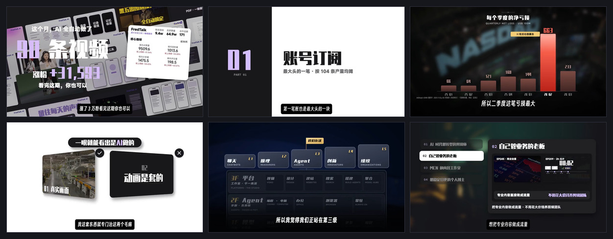

# OrenCut

**33 个可编辑的静音 Remotion 动效，也是一个可在 Codex 里调用的 Agent Skill。** 先从预览挑动作，再把画面、文字和节奏换成自己项目的内容。横屏与竖屏示例均带 TypeScript 源码，保留原组件的字体、素材和动效时序，预览可以直接静音播放。

[在线浏览 33 个动效](https://orenfang.github.io/orencut/)


<details>
<summary>查看六个动效的画面</summary>



</details>

## 动效一览

| 分类 | 数量 | 看片段 |
| --- | ---: | --- |
| 缩略图墙与选中卡移动 | 5 | [23 · 斜向缩略图墙分排滑动，标题逐字落下](previews/23.mp4) |
| 章节落版与双行大字 | 6 | [05 · 黑栏推进、紫色大章节号落下、白页标题揭示](previews/05.mp4) |
| 滚数、环形进度与图表 | 11 | [27 · 竖屏蓝白斜体大数字滚到 1000，黄签补入](previews/27.mp4) |
| 素材缩窗、文件聚焦与空间定位 | 6 | [19 · 地图固定，楼层与 L3 金签逐层定位](previews/19.mp4) |
| 列表、引文与投票逐项揭示 | 5 | [29 · 竖屏流程卡依次打勾，红章落下](previews/29.mp4) |

在 GitHub 选择 **Code → Download ZIP**，解压后双击 `index.html`。本地预览无需安装依赖。可按分类筛选、搜索并点击卡片播放，卡片内也有对应的源码定位。

## 在 Codex 中使用

下载或克隆仓库，将整个文件夹命名为 `orencut`。放到项目的 `.agents/skills/orencut/`，或放到 `~/.agents/skills/orencut/` 供所有项目使用。技能入口是 [SKILL.md](SKILL.md)。

在 Codex 中输入一条任务即可选用组件。

> 用 $orencut 的 27 号滚数动效做一个竖屏片段。数字滚到 256，保留蓝白渐变，换成我的标题，输出静音 MP4。

## 编辑与渲染

在线组件库与本地 `index.html` 都可以直接播放预览。编辑和重新渲染需要原场景素材。

从 GitHub 下载的源码可以通过以下命令导入本地已有的 01 至 10 期可编辑 ZIP。可传入多个目录或 ZIP 路径，需要 Python 3、FFmpeg 和 ffprobe。

```sh
python3 scripts/import-visual-assets.py /本地/可编辑工程目录
```

导入素材后，在 OrenCut 目录安装依赖并启动 Remotion Studio。

```sh
npm ci
npm run studio
```

从左侧选择 `Motion01` 至 `Motion33`，每个合成按自己的画幅、帧率和时长播放。用下面的命令将 23 号动效渲染为 MP4。

```sh
npm run render -- Motion23 out/Motion23.mp4
```

[组件目录](src/catalog.json)记录了每个片段的 `id`、`fps`、`frames`、`portrait` 和场景源码入口。用 [`MotionClip`](src/library.tsx) 按编号嵌入整段动效。

```tsx
import { Sequence } from 'remotion';
import { clips, MotionClip } from './src/library';

const clip = clips.find((item) => item.id === '23')!;

export function MyScene() {
  return (
    <Sequence durationInFrames={clip.frames}>
      <MotionClip id={clip.id} />
    </Sequence>
  );
}
```

父合成使用对应的 `fps` 和画幅，横屏为 1920 × 1080，竖屏为 1080 × 1920。只需要某一层时，按目录定位到对应的 TSX，复用组件或其中的动画逻辑。各场景源码里的 `staticFile()` 标明了原素材路径，可按需替换为自己的素材。

## 许可证

项目代码采用 [MIT](LICENSE)。本地导入的字体和第三方画面适用各自的许可证。
